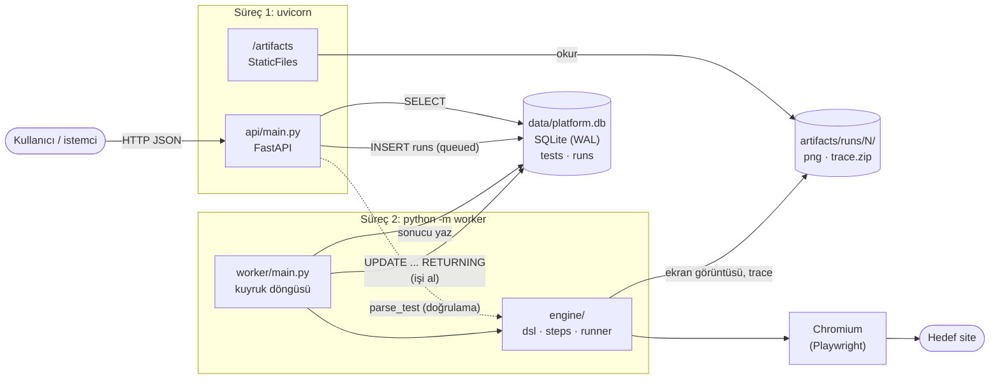

# Bileşen Diyagramı (Aşama 2 sonu)

- API ile worker **ayrı süreçlerdir** ve birbirleriyle doğrudan konuşmaz. Tek ortak noktaları veritabanı ve `artifacts/` klasörüdür.
- Aşama 3'te web arayüzü, Aşama 4'te CI bu resme eklenecek.
