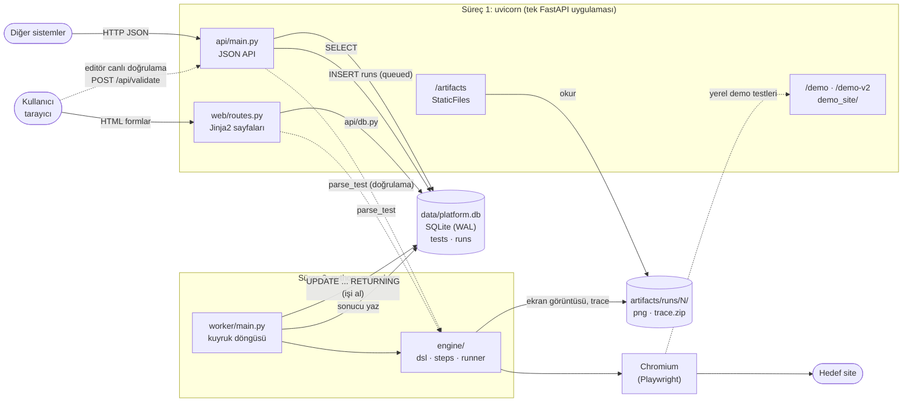

# Bileşen Diyagramı (Aşama 3 sonu)

- API ile worker **ayrı süreçlerdir** ve birbirleriyle doğrudan konuşmaz. Tek ortak noktaları veritabanı ve `artifacts/` klasörüdür.
- Web sayfaları ile JSON API aynı süreçte çalışır ve aynı veritabanı modülünü kullanır (K24).
- Demo sitesi de aynı sunucudan yayınlanır; demo testlerinde "hedef site" odur (K25).
- Aşama 4'te CI bu resme eklenecek.
