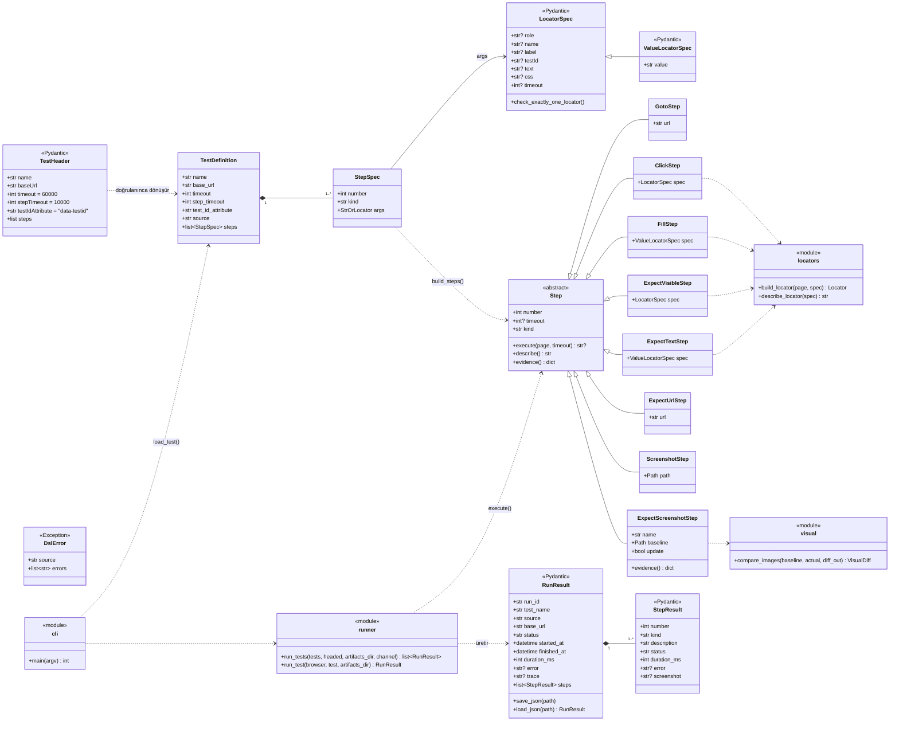

# Test Motoru — Sınıf Diyagramı

GitHub ve VS Code (Markdown Preview Mermaid eklentisi) bu diyagramı doğrudan çizer.
PNG/SVG için: https://mermaid.live adresine kodu yapıştırıp dışa aktarın.

## Okuma notları
- **Command deseni:** `Step` soyut komuttur. Her alt sınıf tek bir YAML adım tipini temsil eder. `runner` sadece `Step` arayüzünü bilir.
- **İki model katmanı:** Pydantic modelleri (`TestHeader`, `LocatorSpec`) YAML'ı **doğrular**. `TestDefinition`/`StepSpec` doğrulanmış, temiz veridir. `Step` nesneleri ise bu veriyi tarayıcıda **uygular**.
- `?` işareti alanın boş (`None`) olabileceğini gösterir.
- `StrOrLocator`: `StepSpec.args` ya düz metindir (`goto`, `expectUrl`, `screenshot`) ya da `LocatorSpec`/`ValueLocatorSpec`'tir (diğer adımlar).
