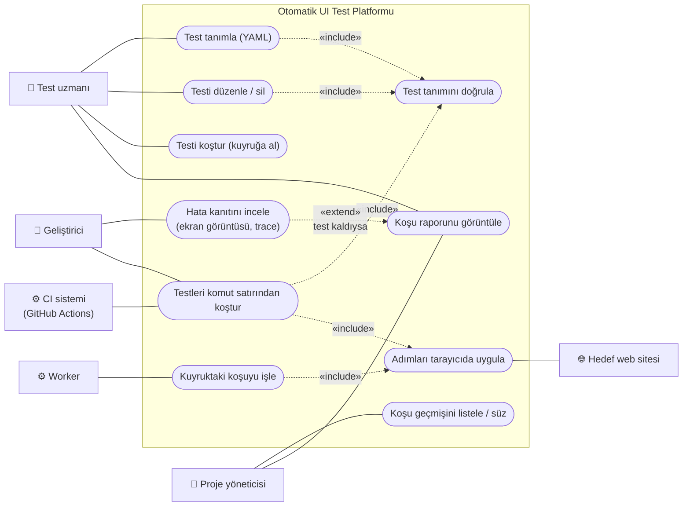
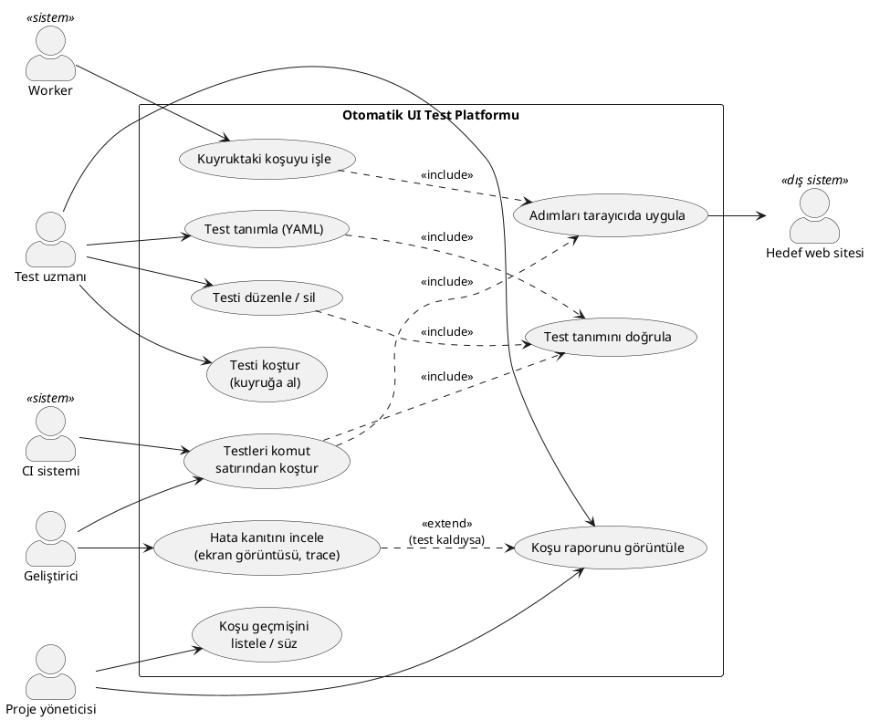

# Use Case Diyagramı

İki sürüm var:
- **Mermaid:** GitHub/VS Code'da doğrudan görünür. Mermaid'in UML use case türü olmadığı için akış diyagramıyla taklit edildi (oval = use case).
- **PlantUML:** Gerçek UML gösterimi (çöp adam aktörler, sistem sınırı). Rapora koymak için bunu kullanın: kodu <https://www.plantuml.com/plantuml> adresine yapıştırıp PNG/SVG indirin ya da VS Code'un PlantUML eklentisini kullanın.

## Mermaid

## PlantUML

## Use case açıklamaları

| Use case | Aktör | Kısa açıklama | Gereksinim |
|----------|-------|---------------|-----------|
| UC1 Test tanımla | Test uzmanı | YAML ile yeni test yazar ve kaydeder. | FR-01, FR-07 |
| UC2 Test tanımını doğrula | (dahil edilen) | Tanım her kayıtta ve koşudan önce doğrulanır; hata Türkçe ve adım numaralı bildirilir. | FR-02 |
| UC3 Testi düzenle / sil | Test uzmanı | Kayıtlı testi günceller ya da siler. | FR-07 |
| UC4 Testi koştur | Test uzmanı | Koşu kuyruğa alınır, istek hemen yanıtlanır. | FR-08 |
| UC5 Koşu raporunu görüntüle | Test uzmanı, Proje yöneticisi | Adım bazında durum, süre, hata. | FR-06, FR-09 |
| UC6 Hata kanıtını incele | Geliştirici | Kalan adımın ekran görüntüsü ve trace dosyası. | FR-05, FR-09 |
| UC7 Koşu geçmişini listele | Proje yöneticisi | Teste/duruma göre süzülmüş geçmiş, testlerin son durumu. | FR-10 |
| UC8 Komut satırından koştur | Geliştirici, CI | `python -m engine run ...`, çıkış koduyla sonuç. | FR-11, FR-13 |
| UC9 Kuyruktaki koşuyu işle | Worker | En eski bekleyen koşuyu atomik olarak alır, sonucu yazar. | FR-08 |
| UC10 Adımları tarayıcıda uygula | (dahil edilen) | Playwright ile Chromium'da adımları uygular, timeout'ları uygular. | FR-03, FR-04 |
